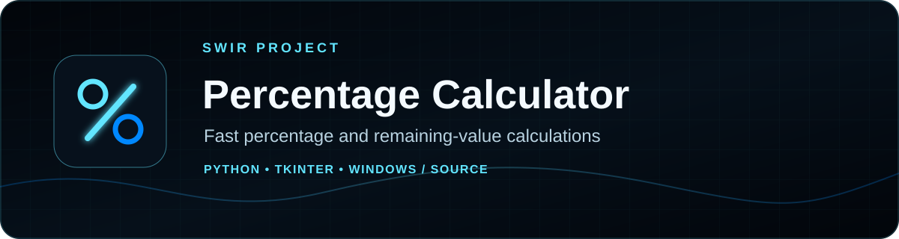
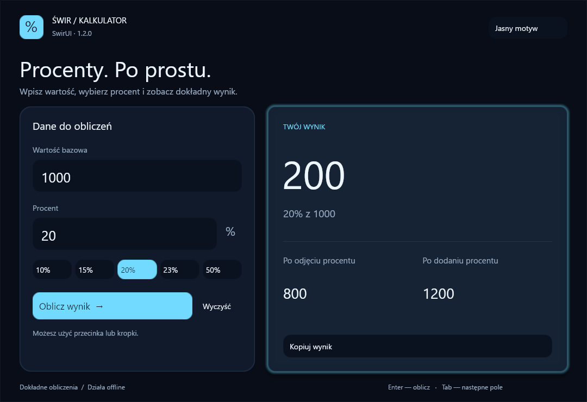
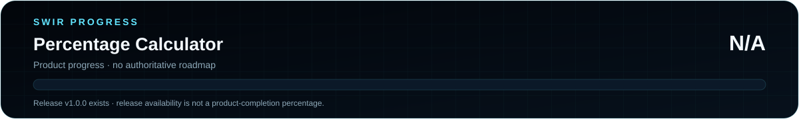

<!-- SWIR-README-STANDARD:v2 -->

<div align="center">



<br>


<br>


[**Highlights**](#-highlights) · [**Quick Start**](#-quick-start) · [**Status**](STATUS.md) · [**Releases**](#-releases)

</div>

## 📸 Screenshot



[Light appearance](docs/screenshots/swirui-light.png). Actual GPU-rendered application frames from v1.2.0.


## 📍 Project Status

| Item | Status |
|---|---|
| Current stage | Released lightweight utility |
| Source version | 1.2.0 |
| Windows download | [Latest verified release](https://github.com/Swir/Procent-calkulator/releases/latest) |
| Runtime | Windows x64 EXE or Python 3.11–3.14 + SwirUI |
| Product roadmap | Not defined; product completion is intentionally **N/A** |
| Detailed status | [STATUS.md](STATUS.md) |



**Product progress: N/A.** This repository has no authoritative product roadmap, so release availability is not presented as a completion percentage.

## 🚀 Overview

**Percentage Calculator** is a small desktop utility that calculates a selected percentage of a base value and the amounts after subtracting or adding it. Version 1.2.0 uses the native SwirUI interface with dark/light appearances. The interface text is Polish and calculations remain exact Decimal arithmetic.

## ✨ Highlights

| Feature | What it does |
|---|---|
| 🔢 Base value | Accepts a numeric starting value |
| `%` Percentage | Calculates the requested percentage of the base value |
| ➖ Remaining value | Shows the amount left after subtracting the calculated percentage |
| 🧯 Input validation | Shows an inline error for empty, malformed, non-finite or oversized input |
| 🎨 SwirUI | Native Windows interface with dark/light themes and a resizable layout |
| ⚡ Quick percentages | 10%, 15%, 20%, 23%, 50%, Enter-to-calculate and copy result |
| ➕ Increased value | Shows the base value plus the selected percentage |
| 🖼️ Icon policy | Own application icon first; otherwise the SwirUI icon for both window and EXE |
| 📦 Windows release | The release workflow verifies the EXE, portable ZIP, checksums and fresh-download runtime before publication |

## ⚙️ Quick Start

### Recommended — Windows release

Download the [latest verified Windows release](https://github.com/Swir/Procent-calkulator/releases/latest). Choose `Procent-Calculator.exe` or the portable Windows x64 ZIP and verify the download against `SHA256SUMS.txt`. Source version 1.2.0 is described in [CHANGELOG.md](CHANGELOG.md).

### From source

```bash
git clone https://github.com/Swir/Procent-calkulator.git
cd Procent-calkulator
python -m pip install --only-binary=:all: -r requirements.txt
python Calculator.py
```

Use 64-bit CPython 3.11–3.14 on Windows. The pinned SwirUI 0.1.0b1 native wheel includes its Rust/wgpu core; no Rust installation is required.

## 📋 Requirements / Compatibility

- **Windows:** Windows x64 with a compatible GPU driver; release packages do not require Python.
- **Source:** 64-bit CPython 3.11–3.14, SwirUI 0.1.0b1 and Pillow 13.0.0.
- **Window:** minimum client size 900 × 720 logical pixels.
- **Language:** the current application UI is Polish.
- SwirUI is pinned to its Windows desktop beta; this application release does not imply framework-wide 1.0 readiness.

## 🎮 Usage

1. Enter the base value in **Wartość bazowa**.
2. Enter the percentage in **Procent**.
3. Select **Oblicz wynik** or press Enter.
4. Read the percentage amount and the values after subtraction/addition. Use **Kopiuj wynik** to copy the exact result.

Example: for a base value of `1000` and `20%`, the application reports `200` as the percentage amount, `800` after subtraction and `1200` after addition.

## 🧠 Technology

| Layer | Technology / role |
|---|---|
| GUI | Python + SwirUI 0.1.0b1 / native Rust-wgpu rendering |
| Calculation | Decimal percentage and subtraction, with no binary floating-point rounding |
| Windows packaging | PyInstaller in the repository release workflow |
| Release artifacts | EXE + ZIP + SHA-256 |

## 🗺️ Roadmap / Progress

There is currently no authoritative product roadmap in this repository. To avoid inventing readiness, product completion remains **N/A**. See [STATUS.md](STATUS.md) for the compact status view.

## 📦 Releases

Download: **[latest verified public release](https://github.com/Swir/Procent-calkulator/releases/latest)**. Source version: **1.2.0**.

The release workflow runs regression tests, builds `Procent-Calculator.exe`, checks the extracted portable ZIP and verifies a fresh download of the draft release before publication. It publishes checksums, source/build provenance and runtime verification results. Existing public releases are never overwritten.

## ⚠️ Current Limitations

- The program implements percentage amount, subtraction and addition; it is not a general expression parser.
- The current UI language is Polish only.
- Inputs accept a comma or point, up to 18 integer digits and 12 fractional digits. Grouping separators and exponent notation are rejected.
- Negative values and percentages above 100 are supported. This is a general percentage utility, not a tax or accounting rules engine.
- No repository product roadmap currently defines a measurable completion percentage.

## 🧪 Verification

```powershell
python -m unittest discover -s tests -v
python Calculator.py --self-test calculator-self-test.json
```

The self-test opens and closes a native test window. It exercises actual controls, both themes, decimal input, invalid values, compact layout, icon assignment and cursor restoration after all eight resize borders/corners. It does not move the mouse or use the system clipboard; copy tests use an isolated in-memory clipboard. The release additionally checks that the EXE icon resources exactly match the selected ICO.

## 🖼️ Application icon

`app_identity.resolve_icon()` is shared by native window setup and Windows packaging. Put an application-specific icon at `assets/icons/app.ico` to give it precedence; otherwise `assets/icons/swirui.ico` is used automatically. Rebuild the EXE after changing the icon. The calculator currently uses the original [SwirUI icon](https://github.com/Swir/Swirui/blob/e7f7701595c0eb9ead7ac20a29510e28596a63e8/assets/swirui-icon.svg), including 16–256 pixel ICO sizes.

## 🔎 Search Keywords

`percentage calculator python` • `windows percentage calculator` • `swirui calculator` • `percentage of value calculator` • `remaining value calculator` • `offline percentage calculator` • `python desktop calculator` • `discount percentage utility` • `commission percentage calculator` • `lightweight windows calculator`


<div align="center">

### `CALCULATE • VERIFY • KEEP IT SIMPLE`

⭐ **If this utility is useful, consider leaving a star.**

[**← SWIR profile**](https://github.com/Swir) · [**All projects →**](https://github.com/Swir?tab=repositories)

</div>
