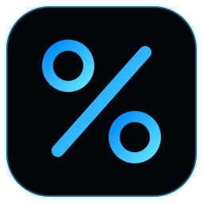
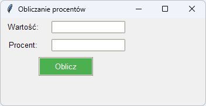

<!-- SWIR-README-STANDARD:v2 -->

<div align="center">


<br>



<br>


[**Highlights**](#-highlights) · [**Quick Start**](#-quick-start) · [**Status**](STATUS.md) · [**Releases**](#-releases)

</div>

## 📸 Screenshot



Initial calculator window on Windows.


## 📍 Project Status

| Item | Status |
|---|---|
| Current stage | Released lightweight utility |
| Source version | 1.1.0 |
| Windows download | [Latest verified release](https://github.com/Swir/Procent-calkulator/releases/latest) |
| Runtime | Windows EXE or Python 3 + Tkinter |
| Product roadmap | Not defined; product completion is intentionally **N/A** |
| Detailed status | [STATUS.md](STATUS.md) |


**Product progress: N/A.** This repository has no authoritative product roadmap, so release availability is not presented as a completion percentage.

## 🚀 Overview

**Percentage Calculator** is a small desktop utility that calculates a selected percentage of a base value and the amount remaining after that percentage is subtracted. The current source is a single-file Python/Tkinter application and its interface text is in Polish.

## ✨ Highlights

| Feature | What it does |
|---|---|
| 🔢 Base value | Accepts a numeric starting value |
| `%` Percentage | Calculates the requested percentage of the base value |
| ➖ Remaining value | Shows the amount left after subtracting the calculated percentage |
| 🧯 Input validation | Shows an inline error for empty, malformed, non-finite or oversized input |
| 🪶 Lightweight source | Uses only Python's standard Tkinter/ttk GUI stack |
| 📦 Windows release | The release workflow verifies the EXE, portable ZIP, checksums and fresh-download runtime before publication |

## ⚙️ Quick Start

### Recommended — Windows release

Download the [latest verified Windows release](https://github.com/Swir/Procent-calkulator/releases/latest). Choose `Procent-Calculator.exe` or the portable Windows x64 ZIP and verify the download against `SHA256SUMS.txt`. Source version 1.1.0 is described in [CHANGELOG.md](CHANGELOG.md).

### From source

```bash
git clone https://github.com/Swir/Procent-calkulator.git
cd Procent-calkulator
python Calculator.py
```

A Python 3 installation with Tkinter support is required when running from source.

## 📋 Requirements / Compatibility

- **Windows:** the published v1.0.0 release is packaged as a Windows x64 executable.
- **Source:** Python 3 with Tkinter/ttk.
- **Language:** the current application UI is Polish.
- No third-party Python package is imported by `Calculator.py`.

## 🎮 Usage

1. Enter the base value in **Wartość**.
2. Enter the percentage in **Procent**.
3. Select **Oblicz**.
4. Read both the calculated percentage amount and the remaining value.

Example: for a base value of `1000` and `20%`, the application reports `200` as the percentage amount and `800` as the remaining value.

## 🧠 Technology

| Layer | Technology / role |
|---|---|
| GUI | Python `tkinter` + `ttk` |
| Calculation | Decimal percentage and subtraction, with no binary floating-point rounding |
| Windows packaging | PyInstaller in the repository release workflow |
| Release artifacts | EXE + ZIP + SHA-256 |

## 🗺️ Roadmap / Progress

There is currently no authoritative product roadmap in this repository. To avoid inventing readiness, product completion remains **N/A**. See [STATUS.md](STATUS.md) for the compact status view.

## 📦 Releases

Download: **[latest verified public release](https://github.com/Swir/Procent-calkulator/releases/latest)**. Source version: **1.1.0**.

The release workflow runs regression tests, builds `Procent-Calculator.exe`, checks the extracted portable ZIP and verifies a fresh download of the draft release before publication. It publishes checksums, source/build provenance and runtime verification results. Existing public releases are never overwritten.

## ⚠️ Current Limitations

- The program implements one calculation flow: percentage amount plus remaining value.
- The current UI language is Polish only.
- Inputs accept a comma or point, up to 18 integer digits and 12 fractional digits. Grouping separators and exponent notation are rejected.
- Negative values and percentages above 100 are supported. This is a general percentage utility, not a tax or accounting rules engine.
- No repository product roadmap currently defines a measurable completion percentage.

## 🧪 Verification

```powershell
python -m unittest discover -s tests -v
python Calculator.py --self-test calculator-self-test.json
```

The self-test creates a hidden application window, exercises the actual Calculate button, checks decimal input and rejects invalid values. It does not move the pointer or use the clipboard.

## 🔎 Search Keywords

`percentage calculator python` • `windows percentage calculator` • `tkinter calculator` • `percentage of value calculator` • `remaining value calculator` • `offline percentage calculator` • `python desktop calculator` • `discount percentage utility` • `commission percentage calculator` • `lightweight windows calculator`


<div align="center">

### `CALCULATE • VERIFY • KEEP IT SIMPLE`

⭐ **If this utility is useful, consider leaving a star.**

[**← SWIR profile**](https://github.com/Swir) · [**All projects →**](https://github.com/Swir?tab=repositories)

</div>
